  

 

  
  
  

 

  

---

### 👨‍💻 About Me

- 🎓 Pursuing **Artificial Intelligence & Data Science** at **Lovely Professional University (LPU)**.
- 💡 Passionate about building **real-world campus utilities**, **interactive web applications**, and **data-driven solutions**.
- 🚀 Experienced in shipping responsive, mobile-ready **Progressive Web Apps (PWAs)** with clean dark-mode UI/UX and live geospatial mapping.
- 🌱 Currently deepening my skills in **Machine Learning, Python Data Pipelines, and Full-Stack JavaScript**.

---

### 🛠️ Tech Stack & Tools

#### 🧠 AI, Data Science & Programming

  
  
  
  
  

#### 🌐 Frontend & Web Engineering

  
  
  
  
  
  

#### ⚙️ Workflow & Deployment

  
  
  
  

---

### 🚀 Featured Projects

| Project | Highlights & Stack | Links |
| :--- | :--- | :--- |
| **🏫 CampusGrid — LPU Navigator & Live Mess Portal** | Interactive **Leaflet.js GPS Campus Map** (20+ LPU landmarks), live clock-synced **7-Day Hostel Mess Menu**, Student & Warden Auth, Digital Verto ID, UMS Rebate Calculator, and installable **PWA**. |   |
| **🧭 LPU Campus Guide** | Mobile-friendly student & visitor portal combining LPU campus directions, hostel dining schedules, meal timings, fee breakdowns, and quick university resources. |   |

---

  Crafted with ⚡ by <strong>Aryan Khan</strong> (<a href="https://github.com/iamaryaann">@iamaryaann</a>)

